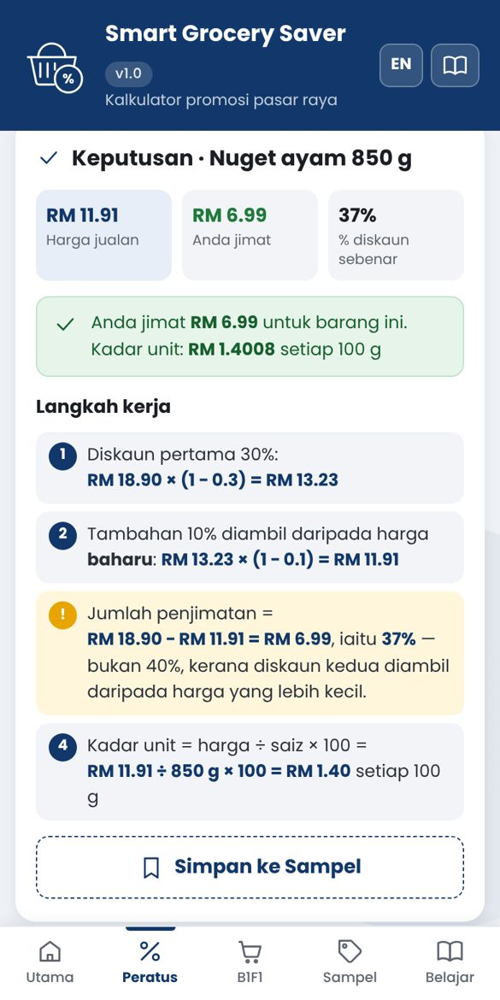

# 🧺 Smart Grocery Saver `v1.0`

Web app percuma untuk menyemak sama ada **promosi pasar raya benar-benar berbaloi** — diskaun peratus, Beli 1 Percuma 1, pek berbilang dan kadar unit — **lengkap dengan langkah kerja**. Dibina untuk pembelajaran matematik kehidupan sebenar (Tingkatan 1–3). Dwibahasa BM / English.

**🔗 Buka app & panduan:** https://g-03355699-tech.github.io/smart-grocery-saver-farhana/

## Ciri-ciri

- **Diskaun peratus** — harga jualan & penjimatan; **diskaun tambahan** (bertindih) yang menunjukkan 20% + 10% = 28%.
- **Peratus songsang** — cari harga asal daripada harga jualan, dengan amaran kesilapan biasa.
- **Beli X Percuma Y**, **X untuk RM T**, **item ke-2 d% diskaun** — harga sebenar sepek, penjimatan RM & %.
- **Kadar unit** (RM setiap 100 g / 100 ml / sebiji) dan **perbandingan dengan saiz pek lain**.
- **Langkah kerja bernombor** untuk setiap pengiraan.
- **Sampel** — 13 contoh promosi (harga rekaan), tapis ikut jenis, susun ikut % jimat / kadar unit / nama, muat ke kalkulator. Pengiraan murid boleh disimpan dan dibandingkan.
- **Belajar** — 6 pelajaran ringkas dengan soalan “Cuba” yang disemak terus.
- **PWA** — boleh dipasang di skrin utama dan digunakan tanpa internet.

## Struktur

| Fail | Kandungan |
|---|---|
| `docs/index.html` | Halaman panduan, cara pasang, kod QR |
| `docs/app/index.html` | App (satu fail HTML: CSS + JS) |
| `docs/app/manifest.json`, `sw.js`, `ikon-*.png` | Pemasangan di telefon & luar talian |
| `docs/derma-qr.png` | QR DuitNow untuk derma |

Tiada pelayan atau Apps Script — semuanya berjalan dalam pelayar. Simpanan (*Sampel* & bahasa) dalam `localStorage` peranti.

## Terbitkan (GitHub Pages)

**Settings → Pages** → Source: *Deploy from a branch*, Branch: `main`, folder `/docs`.

Selepas mengemas kini app, naikkan nilai `CACHE` dalam `docs/app/sw.js` (cth. `sgs-v1.0.1`) supaya telefon yang sudah memasang app mendapat versi baharu.

## Lesen

MIT — © 2026 Nur Ibtisam Farhana
